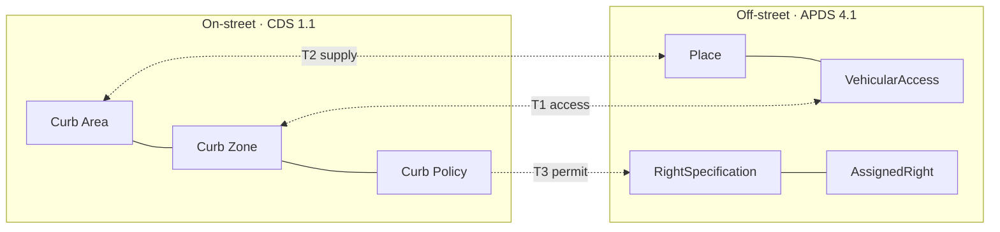

# CDS ↔ APDS Link Profile

**Linking on-street curb data (CDS 1.1) with off-street parking data (APDS 4.1), without merging them.**

The [Curb Data Specification](https://github.com/openmobilityfoundation/curb-data-specification)
(Open Mobility Foundation) describes the **public curb**. The [APDS standard](https://github.com/parkingdata/spec)
(Alliance for Parking Data Standards) describes **garages, lots and other facilities**. This proposal
treats them as two separate domains that stay fully usable on their own, and connects them only
at the three places where the curb meets the facility:

| | Touchpoint | CDS side | APDS side |
|---|---|---|---|
| **T1** | Access: a facility entrance sits on a curb | Curb Zone | `VehicularAccess` |
| **T2** | Nearby off-street supply: the curb is full, so where's the garage? | Curb Area / Zone | `Place` (+ occupancy) |
| **T3** | Shared permits: one permit, honoured at the curb and in the garage | Curb Policy | `RightSpecification` / `AssignedRight` |



**No schema changes are needed.** Every link uses a field that already exists:
CDS `external_references` on one side and APDS `operatorDefinedReference` on the other, plus
standard APDS queries (`/places?latitude&longitude&radius`, `/rights/assigned?credential_id&right_spec`).

## Contents

| Path | What it is |
|---|---|
| [`docs/01-boundary.md`](docs/01-boundary.md) | The domain boundary: what overlaps, what deliberately doesn't |
| [`docs/02-link-profile.md`](docs/02-link-profile.md) | **The normative link profile**: field-level rules, lifecycle, privacy, and upstream schema issues found |
| [`docs/03-link-service.md`](docs/03-link-service.md) | Contract for the optional reference link service |
| [`examples/`](examples) | Worked example payloads (a fictional "Civic District"), validated against the official schemas |
| [`conformance/`](conformance) | Language-neutral test fixtures and cases that every service implementation must pass |
| [`services/python/`](services/python) | Reference link service in Python (FastAPI) |
| [`services/typescript/`](services/typescript) | Reference link service in TypeScript (Fastify) |
| [`tools/validate_examples.py`](tools/validate_examples.py) | Validates every example against the vendored CDS 1.1 and APDS 4.1 schemas |
| [`vendor/`](vendor) | Pinned upstream schema copies with their licences |

## Quick start

```bash
# Validate the example payloads against both official schemas
pip install pyyaml jsonschema
python tools/validate_examples.py

# Python service: tests, then run
cd services/python && pip install -e ".[dev]" && pytest --cov
CDS_BASE_URL=https://cds.example.org APDS_BASE_URL=https://apds.example.org/v4 python -m cds_apds_link

# TypeScript service: tests, then run
cd services/typescript && npm install && npm test && npm run build
CDS_BASE_URL=https://cds.example.org APDS_BASE_URL=https://apds.example.org/v4 npm start
```

## Status

Proposal v0.1, not endorsed by the Open Mobility Foundation or APDS. The upstream schema issues
listed in [profile §2.9](docs/02-link-profile.md#29-upstream-schema-issues-found) are being reported upstream:
the APDS one as [parkingdata/spec#33](https://github.com/parkingdata/spec/issues/33); drafts for the CDS ones
are in [`docs/upstream-issues/`](docs/upstream-issues).

Licences: the vendored specifications keep their own licences (APDS: MIT; CDS OpenAPI: CC BY 4.0).
See [`vendor/README.md`](vendor/README.md).
