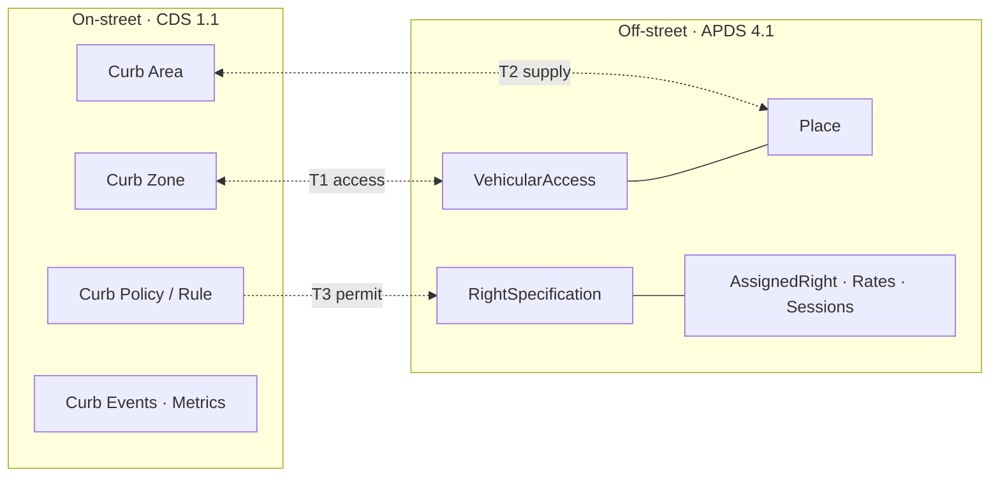

# 1. Domain boundary: CDS (on-street) and APDS (off-street)

**Status:** Proposal, v0.1 · **Applies to:** CDS 1.1.0, APDS 4.1

## 1.1 Principle: linked, not merged

The Curb Data Specification (CDS) and the APDS standard are treated as **two separate domains**:

| | CDS 1.1 | APDS 4.1 |
|---|---|---|
| Domain | **On-street**: the public curb | **Off-street**: garages, surface lots and other facilities |
| Typical publisher | City or agency (Curbs API), with sensors, fleets and payment providers (Events) | Facility operator or parking platform |
| API style | Mostly read-only feeds (`GET`), plus an events push endpoint | Full CRUD data store with versions, webhooks and quotes |
| Core objects | Curb Area, Curb Zone, Curb Space, Curb Object, Policy/Rule, Curb Event, Session, Aggregate | Campus, Place, SubPlace, Space, IdentifiedArea/VehicularAccess, RightSpecification, AssignedRight, RateTable, Session, Observation |

Each specification must remain **fully usable on its own**. Nothing in this profile changes either
standard, adds required fields, or asks one side to understand the other's data model.

When one organisation, or two cooperating organisations, runs both, the two datasets can be
**linked** at the small number of places where the curb physically or legally meets the
facility. A link is a **reference to the counterpart record**, never a copy or translation of it.

> APDS can also model on-street parking (a Place may be an on-street zone, and
> OperatingRestrictions include `streetCleaning` and `loadingZone`). **This profile does not use
> APDS for on-street data.** For every real-world object there is exactly one source of truth:
> CDS for the curb, APDS for the facility.

## 1.2 The overlap: three touchpoints and a shared foundation

| # | Touchpoint | Real-world reason | CDS side | APDS side | Link direction |
|---|---|---|---|---|---|
| **T1** | **Access** | A facility entrance or exit sits on a curb. The curb zone in front of it is usually a no-stopping or no-parking apron | Curb Zone (or a Curb Object such as `signage`) | `VehicularAccess` (a HierarchyElement with `accessType` `entry`, `exit` or `reversible`) | Both directions |
| **T2** | **Nearby off-street supply** | The curb is full, so drivers, wayfinding apps and curb managers need nearby garage capacity | Curb Area (or Curb Zone) | `Place`, with its `supply`, `demandTable`, `characteristics` and rates | Both directions, plus dynamic radius search |
| **T3** | **Shared permits** | One permit programme, such as a residential or commercial permit, is honoured at the curb **and** in a facility | Policy → Rule with `user_classes`/`purposes` containing `permit`; Events carry `vehicle_permit_number` or `vehicle_license_plate` | `RightSpecification` (`type: permitParking`) and the `AssignedRight`s issued under it | CDS → APDS only (see §2.5) |
| — | **Shared foundation** | Makes T1–T3 work with no field translation | UUIDs, GeoJSON (RFC 7946, WGS 84), UTC instants, amounts in minor currency units | UUIDs, GeoJSON (RFC 7946, WGS 84), UTC instants, `AmountInCurrency` | n/a |

## 1.3 Explicit non-goals

The following stay entirely inside their own specification and are **not** mapped:

- **CDS only:** Policy priority semantics, curb activities (`loading`, `stopping`, `travel`…),
  Curb Space and Curb Object inventory, curb events other than permit checks, Metrics
  sessions and aggregates, and lane blocking.
- **APDS only:** Sessions and Segments, quotes, rate calculation, contacts and organisations,
  observations, and the internal facility hierarchy below the access point (levels, rows, spaces).
- **No session hand-off.** A vehicle leaving the curb and entering a garage is two independent
  records, one in each system. Correlating them would mean tracking individual vehicles, which
  raises privacy issues and is out of scope.
- **No rate translation.** A CDS consumer that needs garage prices follows the reference and reads
  APDS `/rates` in APDS form.

## 1.4 Why this is enough

For T1 and T2, both specifications already have a native field for pointing at an external
record: CDS `external_references` on Areas, Zones, Spaces, Objects and Policies, and APDS
`operatorDefinedReference` on every HierarchyElement. For T3, the CDS side has the same hook, and
APDS already exposes a query (`GET /rights/assigned?credential_id=…&right_spec=…`) that answers
"does this vehicle hold this permit?". The link profile ([02-link-profile.md](02-link-profile.md))
only has to standardise **how those existing fields are filled in**.
