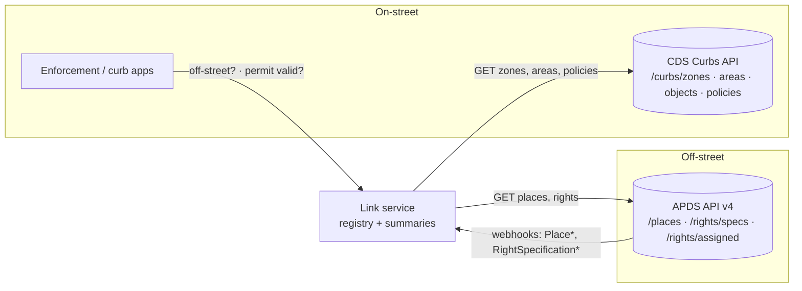

# 3. Reference link service

**Status:** Proposal v0.1 · Implementations: [`services/typescript`](../services/typescript) and [`services/python`](../services/python)

The link service is **optional**. Everything in the [link profile](02-link-profile.md) works with the
two standard APIs alone. The service exists for consumers that want the three touchpoints answered
in one call, without implementing the profile themselves. It adds three things neither spec has:

1. a **link registry**, the reverse index needed for permit programmes (§2.5) plus one-sided and broken link detection;
2. a **nearby off-street summary** for a curb zone (T2);
3. a **permit check** for a curb zone and a credential (T3).

It stores no parking data of its own. Everything is read on demand from the CDS Curbs API and the
APDS API; the registry is a cache that can be rebuilt at any time.



Both implementations MUST pass the shared conformance suite in [`conformance/`](../conformance).

## 3.1 Configuration (environment variables)

| Variable | Required | Default | Meaning |
|---|---|---|---|
| `CDS_BASE_URL` | yes | | CDS server root; `/curbs/...` is appended |
| `CDS_TOKEN` | no | | Sent as `Authorization: Bearer …` |
| `APDS_BASE_URL` | yes | | APDS root **including** the version prefix, e.g. `https://apds.example.org/v4` |
| `APDS_TOKEN` | no | | APDS credential |
| `APDS_AUTH_SCHEME` | no | `bearer` | `bearer` sends `Authorization: Bearer`; `mcc` sends `X-MCC-Access-Token` (legacy APDS) |
| `LINK_WEBHOOK_TOKEN` | no | | If set, `POST /webhooks/apds` requires header `X-Link-Webhook-Token` with this value |
| `DEFAULT_RADIUS_M` | no | `400` | Default search radius for off-street summaries |
| `HTTP_TIMEOUT_MS` | no | `10000` | Timeout for each upstream call |
| `HOST` | no | `0.0.0.0` | Listen address |
| `PORT` | no | `8080` | Listen port |

## 3.2 Response envelope

Every response is JSON:

```json
{ "success": true,  "data": { }, "error": null }
{ "success": false, "data": null, "error": { "code": "not_found", "message": "curb zone … not found" } }
```

| HTTP | `error.code` | When |
|---|---|---|
| 400 | `invalid_request` | Missing or invalid parameters or body, or an unknown webhook event type |
| 401 | `unauthorized` | Webhook token missing or wrong |
| 404 | `not_found` | Curb zone does not exist upstream, or the route does not exist (unknown path, or a known path with the wrong method) |
| 500 | `internal_error` | Any unexpected failure. The message is always `internal error` and never includes exception text |
| 502 | `upstream_error` | CDS or APDS failed, timed out or returned malformed data |

Unknown routes and wrong methods both answer `404 not_found` with the message `route not found`; there is no `405`.

## 3.3 Registry and sync

The registry is built by **harvesting** both sides:

- **CDS:** `GET /curbs/zones`, `/curbs/areas`, `/curbs/policies` and `/curbs/objects` (a 404 on the
  optional objects endpoint means "none"). Every `external_references[]` entry whose `name` is `APDS`
  (case-insensitive) is a declared link. The target id is `ids[0]`, or else the last path segment of
  `reference_url`. The target collection is `places` or `rights/specs`, taken from the URL path.
  A `reference_url` that isn't an absolute `http(s)` URL is reported as `invalid_reference`.
- **APDS:** `GET /places?page=1…` and `GET /rights/specs?page=1…`, paging until all `meta.total`
  items are read. Every HierarchyElement whose `operatorDefinedReference.className` is one of
  `CdsCurbZone | CdsCurbArea | CdsCurbSpace | CdsCurbObject` is a declared link.

**Kind resolution** (profile §2.2):

| CDS end | APDS end | Kind |
|---|---|---|
| CurbPolicy | RightSpecification (`rights/specs`) | `permit` |
| CurbZone, CurbArea, CurbSpace or CurbObject | HierarchyElement with `type` `vehicularAccess` | `access` |
| CurbZone, CurbArea, CurbSpace or CurbObject | HierarchyElement of any other type | `supply` |
| anything else (e.g. a policy pointing at `places`) | | ignored, reported as `invalid_reference` |

**Merging:** declarations with the same `(cds.type, cds.id, apds.id)` merge into one link with
`status` set to `confirmed` (both sides), `cds_only` or `apds_only`.

**Issues** (sorted by `code`, then `cds.id`, then `apds.id`, then `detail`):

| `code` | Meaning |
|---|---|
| `apds_target_missing` | A CDS reference points to an APDS id that does not exist. The link is kept, as `cds_only` |
| `cds_target_missing` | An APDS reference points to a CDS id that does not exist and cannot be resolved via `prev_curb_zone_ids`. The link is dropped |
| `stale_cds_reference` | An APDS reference points to a **previous** curb zone id. The link is re-pointed to the current zone |
| `invalid_reference` | A reference whose ends cannot form a link kind |

Links are sorted by `kind`, then `cds.type`, then `cds.id`, then `apds.id`. The service syncs lazily on the
first request that needs data, and again on every `POST /sync`.

A **link** object: `{ "kind", "status", "cds": { "type", "id" }, "apds": { "type", "id" } }`, where
`cds.type` is one of `CurbZone | CurbArea | CurbSpace | CurbObject | CurbPolicy` and `apds.type` is the
HierarchyElement `type` (e.g. `place`, `vehicularAccess`) or `RightSpecification`. When the APDS target
is missing, `apds.type` is `place` or `RightSpecification`, based on the URL collection.

Upstream fields the service reads as text (`name`, `reference_url`, `className`, `type`,
`validityStatus`, an AssignedRight's `id`) count as **absent** when they are not strings: no
`APDS` reference, an unusable URL, no link, `type` `place`, no inactive status, and an empty id when
ordering rights.

## 3.4 Endpoints

Each query parameter an endpoint defines may be given at most once; a repeated one is `400 invalid_request`.

### `GET /health`
`data: { "status": "ok", "links": <count>, "last_sync": <ISO-8601 or null> }`. Never triggers a sync.

### `POST /sync`
Re-harvests both sides. `data: { "links": [Link], "issues": [Issue], "synced_at": <ISO-8601> }`.

### `GET /links?cds_id=&apds_id=&kind=`
All filters are optional and combined with AND. `data: [Link]`.

### `GET /issues`
`data: [Issue]`, where an Issue is `{ "code", "cds": {type,id} | null, "apds": {type,id} | null, "detail" }`.

### `GET /zones/{curb_zone_id}/off-street?radius_m=`
Nearby off-street supply for a curb zone (T2). `radius_m` must be an integer from 1 to 5000, and defaults to `DEFAULT_RADIUS_M`.

1. Fetch the zone: `GET {CDS}/curbs/zones/{id}` (404 upstream → 404).
2. **Origin** = mean of the zone geometry's vertices (Polygon: outer ring without the closing
   vertex; LineString: all vertices), rounded to 6 decimals.
3. Radius search: `GET {APDS}/places?latitude=&longitude=&radius={radius_m}&type=place&expand=occupancy,pointLocation,characteristics`.
4. **Linked places** are those reached through a `supply` link to the zone, a `supply` link to any
   of the zone's `curb_area_ids`, or an `access` link from the zone to a VehicularAccess whose `parentId` is the place.
   Linked places are always included (from the registry), even outside the radius.
5. For each place:

| Field | Rule |
|---|---|
| `id`, `version` | from APDS |
| `name` | first `name[].string` whose language is `en`, else the first entry |
| `linked` | step 4 |
| `distance_m` | haversine distance (R = 6 371 008.8 m) from the origin to `indicativePointLocation[0]` (Point), rounded half-up to an integer; `null` if the place has no point |
| `spaces_total` | `supply[]` entry with `supplyViewType: spaceView` → `supplyQuantity`; else `characteristics.spacesTotal`; else `null` |
| `spaces_available` | profile §2.4: `spaces_total − count` of the latest `demandType` record (floored at 0); else `round_half_up(spaces_total × (1 − percentage/100))`; else `null` |
| `occupancy_time` | `recordDateTime` of the latest `demandType` record, else `null`. "Latest" compares `recordDateTime` read as a timestamp (rules in `POST /permits/verify` step 5); records whose time does not parse are ignored |
| `open_to_public` | `characteristics.openToPublic`, else `null` |
| `access_points` | VehicularAccess elements whose `parentId.id` is this place: `{ id, name, access_type, curb_zone_id }`, where `curb_zone_id` comes from their `access` link (or `null`); sorted by `id` |
| `apds_url` | `{APDS_BASE_URL}/places/{id}` |

6. Sort by `linked` (true first), then `distance_m` (nulls last), then `id`.

`data: { "curb_zone_id", "origin": { "lat", "lng" }, "radius_m", "places": [...] }`

### `POST /permits/verify`
The permit check (T3). The credential goes in the body, never in the URL.

```json
{ "curb_zone_id": "…", "credential": "ZA-004217", "credential_type": "permit", "at": "2026-06-01T12:00:00Z" }
```

`credential_type` is optional (`permit` or `licensePlate`); `at` is optional (ISO-8601 UTC) and defaults to now.

1. Fetch the zone, then each policy in `curb_policy_ids` (`GET {CDS}/curbs/policies/{id}`).
2. **Programmes** = pairs `(curb_policy_id, right_specification_id)` from policies that have a rule with
   `permit` in `user_classes` or `purposes` **and** an APDS `external_reference` to `rights/specs`.
   Sorted by `right_specification_id`, then `curb_policy_id`. If there are none, `result: "no_programme"`.
3. Normalise the credential: trim it and upper-case it. Query
   `GET {APDS}/rights/assigned?right_spec={ids,comma-separated}&credential_id={credential}&credential_type={type or "permit,licensePlate"}`.
4. **Candidates** are returned rights whose `rightSpecification.id` is a programme id and that hold a credential
   equal to the presented one after removing spaces and hyphens and upper-casing both.
5. Evaluate each candidate at `at`, checking in this order: `issuanceTime > at` → `not_yet_valid`;
   `expiry ≤ at` → `expired`; the RightSpecification (`GET {APDS}/rights/specs/{id}`) is `suspended` or `planned`, or
   `at` is outside `overallStartTime`/`overallEndTime` → `programme_inactive`; otherwise `valid`.
   Timestamps must match `YYYY-MM-DD[THH:MM[:SS[.fff]]][Z|±HH:MM]` (no offset means UTC), name a real calendar
   date and time (no `02-30`, `24:00` or leap second; offset minutes below 60) and fall within years 0001–9999
   in UTC. Fractional seconds are truncated to milliseconds before comparing. The same rules apply to `at`,
   where a violation is `400 invalid_request`. A timestamp that is **present but does
   not match fails its check** (fail closed): an unreadable `expiry` counts as expired, never as "no expiry".
6. `result` is `valid` if any candidate is valid. Otherwise it's the outcome of the candidate with the latest
   `expiry` (ties broken by `id`), or `not_found` if there are no candidates. `assigned_right` describes the
   deciding candidate (for `valid`, the valid candidate with the latest `expiry`).

`data: { "curb_zone_id", "at", "programmes": [{ "curb_policy_id", "right_specification_id" }], "result",
"assigned_right": { "id", "version", "expiry" } | null, "credential_masked" }`

`credential_masked` keeps the first and last 3 characters of the normalised credential (`ZA-***217`), or is all
`*` when the credential has 6 characters or fewer. The service MUST NOT log credentials.

### `POST /webhooks/apds`
Receives APDS `EventData` callbacks (profile §2.7). The header `X-APDS-Event-Type` is required.

| Event | Effect |
|---|---|
| `PlaceCreated`, `PlaceUpdated` | Upsert the HierarchyElement and rebuild links |
| `PlaceDeleted` | Remove the element by `id` and rebuild links |
| `RightSpecificationCreated`, `…Updated` | Upsert the RightSpecification and rebuild links |
| `RightSpecificationDeleted` | Remove it and rebuild links |
| any other `EventTypeEnum` value | Accepted but ignored: `applied: false` |

`data: { "event_type", "applied" }`. Rebuilding links reuses the last CDS harvest, so no CDS call is made.
If the registry has never synced, the service syncs first and then applies the event.

## 3.5 Security and privacy

- Upstream tokens come from the environment only, and are never logged or returned.
- Credentials (permit numbers, plates) are accepted only in request bodies, are masked in responses, and never appear in logs.
- Webhook calls can be protected with `LINK_WEBHOOK_TOKEN`, compared in constant time.
  APDS defines no signature scheme, so deployments SHOULD also restrict the webhook route at the network level.
- Upstream responses are treated as untrusted: malformed payloads produce `502 upstream_error`, not crashes.
  A `meta.total` that isn't an integer stops paging after the current page.
- Caller-supplied ids are percent-encoded as a single path segment before they reach an upstream URL, so a
  `curb_zone_id` such as `../admin?x=1` cannot address other upstream paths with the service's credentials.
  An id that is exactly `.` or `..` cannot be kept a single segment (URL normalisation resolves it), so it is
  never sent upstream and is treated as if upstream had answered 404: `404 not_found` for a curb zone, and a
  missing policy or right specification otherwise.
- Request bodies are limited to 1 MiB (`400 invalid_request` beyond that).
- Webhook upserts of **new** ids are refused (`400 invalid_request`) once the registry holds 100 000 elements or
  100 000 right specifications. Updates to known ids and deletions are always applied.
