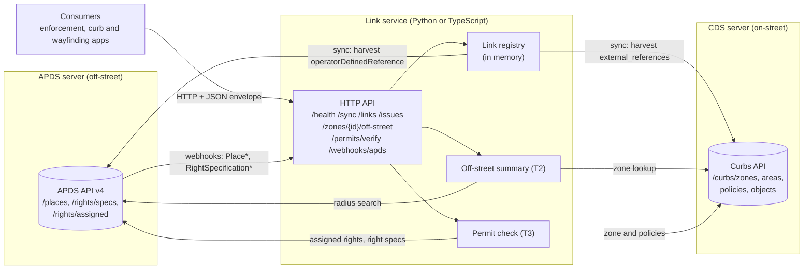
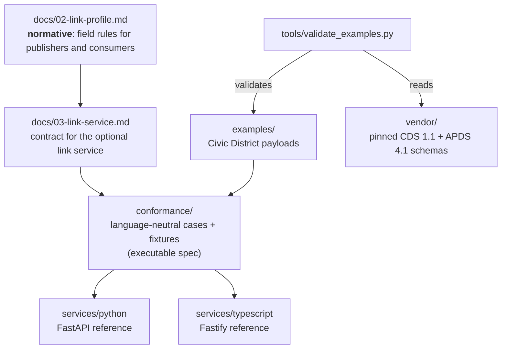

# Architecture overview

## The idea in one paragraph

Two open standards describe parking. **CDS 1.1** (Open Mobility Foundation) describes the public curb.
**APDS 4.1** (Alliance for Parking Data Standards) describes garages, lots and other facilities. This project
does not merge them. It links them at three touchpoints, using fields that already exist in both standards
([ADR 0001](../decisions/0001-link-not-merge.md), [ADR 0002](../decisions/0002-existing-fields-only.md)).

| | Touchpoint | CDS side | APDS side |
|---|---|---|---|
| **T1** | Access: a facility entrance sits on a curb | Curb Zone (or Curb Object) | `VehicularAccess` |
| **T2** | Nearby off-street supply | Curb Area or Curb Zone | `Place` (with occupancy) |
| **T3** | Shared permits | Curb Policy | `RightSpecification` and its `AssignedRight`s |

The full boundary is in [docs/01-boundary.md](../01-boundary.md).

## Runtime view

The link service is optional. Any consumer can follow the profile using the two standard APIs alone.
The service answers the three touchpoints in one call and keeps a link registry (a reverse index).

How data moves:

1. **Sync.** The registry harvests both servers: CDS `external_references` and APDS
   `operatorDefinedReference`. It runs lazily on the first request that needs links, and again on every
   `POST /sync`. See [Data model](data-model.md).
2. **Webhooks.** APDS can push `Place*` and `RightSpecification*` events to `POST /webhooks/apds`.
   The service updates its APDS copy and rebuilds links from the last CDS harvest. CDS has no change
   notifications, so CDS changes arrive only through a sync.
3. **Live reads.** The off-street summary (T2) and the permit check (T3) read the curb zone, policies,
   places and rights from upstream on each request. Only the registry is cached.

The service stores no parking data of its own. The registry is a cache and is rebuilt after a restart.

## Where each part fits

- **The profile is normative.** Code follows the profile, not the other way round.
- **The services are reference implementations.** There are two, so that the profile does not look tied
  to one language ([ADR 0003](../decisions/0003-two-reference-services.md)). They must behave identically.
- **The conformance suite holds them equal.** Both services run the same `conformance/cases.json`
  against the same fake upstream data. A third-party implementation can use it too.
- **Examples are validated** against the official schemas in `vendor/`. Upstream schema bugs are patched
  in memory only ([ADR 0004](../decisions/0004-vendor-pinned-schemas.md)).

## Technology

| Part | Stack |
|---|---|
| Python service | Python 3.11+, FastAPI, httpx, uvicorn; tests with pytest and pytest-cov |
| TypeScript service | Node 20+, Fastify 5, built-in `fetch`; tests with vitest; compiled with `tsc` |
| Example validator | Python, PyYAML, jsonschema (Draft 2020-12) |
| CI | GitHub Actions (`.github/workflows/ci.yml`): validator, Python 3.11 and 3.13, Node 20 and 22 |
