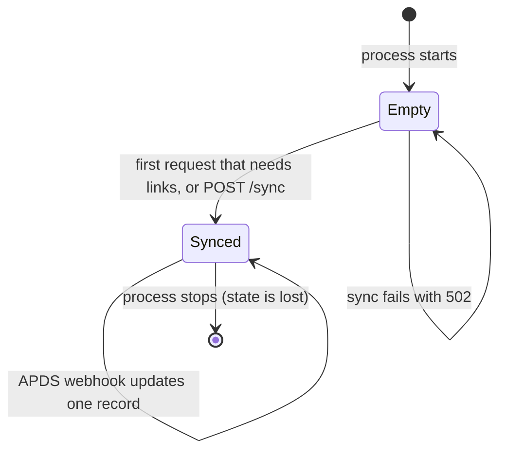

# Data model

The service has no database. Its only state is the in-memory **link registry**: copies of the harvested CDS
and APDS records, and the links and issues derived from them. This page explains how that state is built.
The normative rules are in the profile and the contract; this page points to them rather than repeating them.

## Links

A link joins one CDS record to one APDS record ([profile §2.1](../02-link-profile.md#21-link-model)).
In the service a link is:

```json
{ "kind": "access", "status": "confirmed",
  "cds":  { "type": "CurbZone", "id": "..." },
  "apds": { "type": "vehicularAccess", "id": "..." } }
```

| Field | Values |
|---|---|
| `kind` | `access` (T1), `supply` (T2), `permit` (T3) |
| `status` | `confirmed` (declared on both sides), `cds_only`, `apds_only` |
| `cds.type` | `CurbZone`, `CurbArea`, `CurbSpace`, `CurbObject`, `CurbPolicy` |
| `apds.type` | The HierarchyElement `type` (for example `place`, `vehicularAccess`), or `RightSpecification` |

The kind is never stored in either standard. The service derives it from the two ends
([contract §3.3](../03-link-service.md#33-registry-and-sync), "Kind resolution"):

| CDS end | APDS end | Kind |
|---|---|---|
| CurbPolicy | RightSpecification | `permit` |
| CurbZone, CurbArea, CurbSpace or CurbObject | HierarchyElement with `type: vehicularAccess` | `access` |
| CurbZone, CurbArea, CurbSpace or CurbObject | HierarchyElement of any other type | `supply` |
| anything else | | no link; an `invalid_reference` issue |

Note: the service is wider than the profile table in §2.1. It accepts any non-policy CDS type at either end
of `access` and `supply`, and treats any HierarchyElement type other than `vehicularAccess` as `supply`.

## Harvesting

`registry.py` / `registry.ts` read links from both sides. The full rules are in
[contract §3.3](../03-link-service.md#33-registry-and-sync); in short:

### From CDS: `external_references`

Source: `GET /curbs/zones`, `/curbs/areas`, `/curbs/policies` and `/curbs/objects` (a 404 on objects means
"none"). Each list is read in one request.

1. Take every entry of the record's `external_references` whose `name` is `APDS` (case-insensitive).
2. Parse `reference_url`. It must be an absolute `http` or `https` URL, otherwise the reference is unusable.
3. Find the collection in the URL path: `.../rights/specs/...` or `.../places/...`.
4. The target id is `ids[0]` if present, else the path segment after the collection.
5. If no collection or id can be found, record an `invalid_reference` issue.

Rules: [profile §2.2](../02-link-profile.md) (CDS → APDS).

### From APDS: `operatorDefinedReference`

Source: `GET /places?page=1...` and `GET /rights/specs?page=1...`, paging until `meta.total` items are read.

1. Take every HierarchyElement whose `operatorDefinedReference.className` is `CdsCurbZone`, `CdsCurbArea`,
   `CdsCurbSpace` or `CdsCurbObject`, and whose `operatorDefinedReference.id` is a string.
2. Map the class name to the CDS type (`CdsCurbZone` → `CurbZone`, and so on).
3. If the CDS id is unknown but a current Curb Zone lists it in `prev_curb_zone_ids`, re-point the link to
   the current zone and record `stale_cds_reference`.
4. If the CDS id is still unknown, record `cds_target_missing` and drop the link.

RightSpecification has no `operatorDefinedReference`, so `permit` links are always declared on the CDS side
only ([ADR 0002](../decisions/0002-existing-fields-only.md)). Rules: [profile §2.3](../02-link-profile.md)
and §2.5.

### Merging

Declarations with the same `(cds.type, cds.id, apds.id)` become one link. Its `status` is `confirmed` if both
sides declared it, else `cds_only` or `apds_only`. Links are sorted by `kind`, `cds.type`, `cds.id`, `apds.id`.

## Issues

An issue is `{ "code", "cds": {type,id} | null, "apds": {type,id} | null, "detail" }`. Issues are sorted by
`code`, then `cds.id`, then `apds.id`. Duplicates are removed.

| Code | Raised when | What happens to the link |
|---|---|---|
| `apds_target_missing` | A CDS reference names an APDS id that was not harvested | Kept, as `cds_only` |
| `cds_target_missing` | An APDS reference names a CDS id that was not harvested and is not in any `prev_curb_zone_ids` | Dropped |
| `stale_cds_reference` | An APDS reference names a previous curb zone id | Re-pointed to the current zone |
| `invalid_reference` | A reference whose ends cannot form a kind, or whose URL is unusable | No link |

Lifecycle rules for ids and versions are in [profile §2.6](../02-link-profile.md#26-identity-and-lifecycle).

## Registry lifecycle



1. **Empty.** At start the registry holds nothing. `GET /health` reports `links: 0` and `last_sync: null`.
   `/health` never triggers a sync.
2. **First sync.** The first request that needs links runs a full harvest. All six upstream reads must
   succeed. If any fails, the request returns `502 upstream_error` and the registry stays as it was.
3. **Re-sync.** `POST /sync` re-harvests both sides and replaces the whole registry. `last_sync` is set to the
   service clock, to the second.
4. **Webhook updates.** `POST /webhooks/apds` upserts or removes one APDS element or right specification and
   rebuilds the links. It reuses the last CDS harvest, so it makes no CDS call. If the registry has never
   synced, the service syncs first. New ids are refused once 100 000 elements (or 100 000 right
   specifications) are held; updates and deletions are always applied.
5. **Restart.** Everything is lost. The next request that needs links triggers a new sync.

Concurrent syncs: the TypeScript service shares one in-flight sync between concurrent callers. The Python
service runs them one after another behind a lock, so each caller gets its own harvest. Both end in the same
state.

`POST /permits/verify` does not use the registry. It reads the zone, its policies, the assigned rights and
the right specifications live on each call ([contract §3.4](../03-link-service.md#34-endpoints)). The
off-street summary uses the registry only to find linked places and access points; places and occupancy are
read live.

## Known gap: Curb Spaces

The harvest reads zones, areas, policies and objects from CDS, but not spaces. As a result an APDS element
whose `operatorDefinedReference.className` is `CdsCurbSpace` never finds its CDS target. It is reported as
`cds_target_missing` and dropped, even though the contract lists `CurbSpace` as a valid CDS end.
