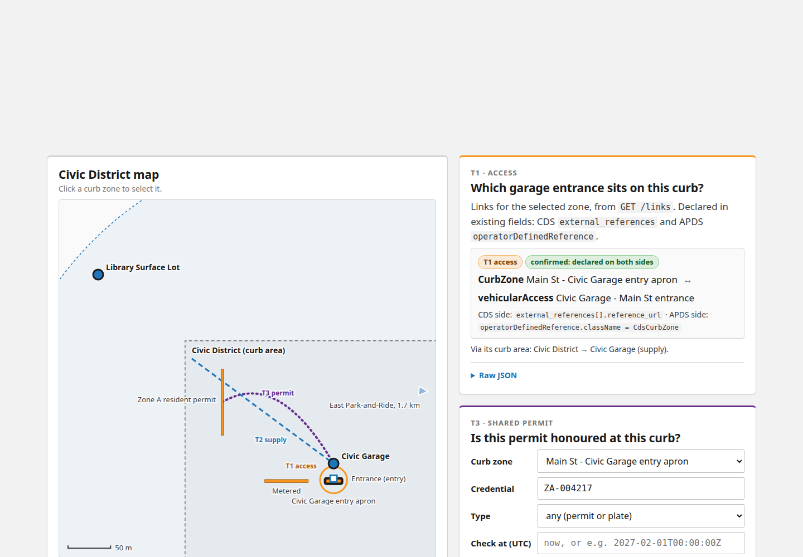
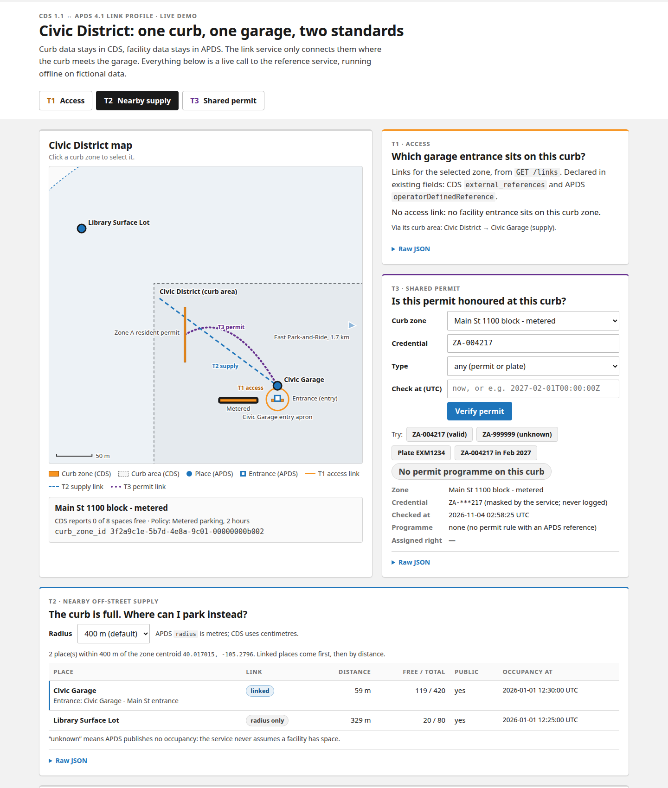
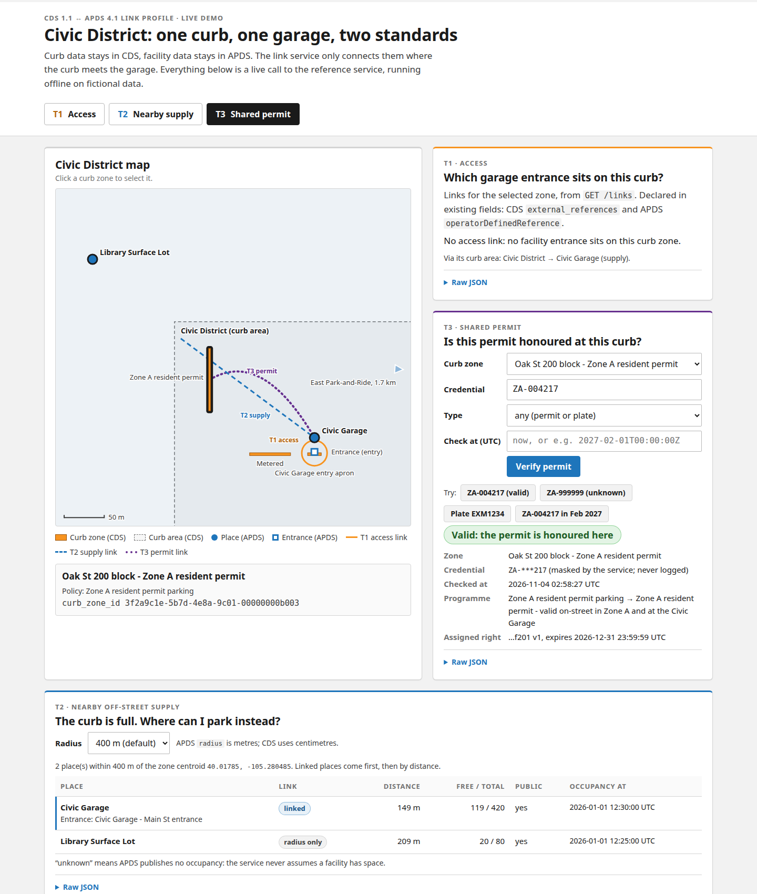
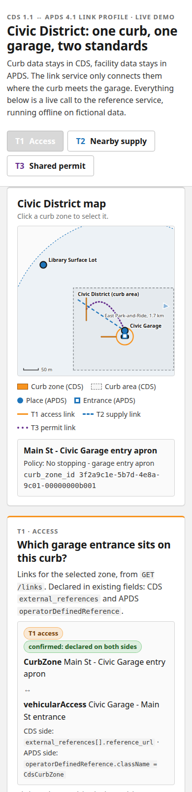

# Using the Civic District demo

The demo is one web page that shows the three places where curb data (CDS) and off-street parking data (APDS)
meet. Every panel is a live call to the reference link service. It runs offline on fictional sample data, so you
can click anything without affecting a real system.

## Start the demo

1. From the repository root, install the Python service: `pip install -e services/python`.
2. Start the demo: `python demo/server.py`. Add `--port 8123` to use another port.
3. Open http://127.0.0.1:8742/demo/ in a browser.

To jump straight to one step, add `#t1`, `#t2` or `#t3` to the address, for example
http://127.0.0.1:8742/demo/#t2.

## The page

| Part | What it shows |
|---|---|
| **T1 Access**, **T2 Nearby supply**, **T3 Shared permit** buttons | Each button selects the curb zone that best shows that step and highlights its panel. |
| **Civic District map** | Curb zones (orange bars), the curb area (dashed box), garages and lots (blue dots) and garage entrances (blue squares). The lines are the links between them: solid orange for access, dashed blue for supply, dotted purple for permits. Click a curb zone to select it. |
| Zone box under the map | The selected zone's name, its CDS policy and its `curb_zone_id`. |
| **Raw JSON** (under each panel) | The exact response from the link service, for people who want to see the payloads. |

## T1: which garage entrance sits on this curb?

1. Click **T1 Access**. The page selects *Main St - Civic Garage entry apron*.
2. The **T1 · Access** panel shows the link between the curb zone and the garage entrance.
   **confirmed: declared on both sides** means CDS and APDS each point at the other.
3. A zone with no entrance on it says **No access link**.

## T2: the curb is full, where can I park instead?

1. Click **T2 Nearby supply**. The page selects *Main St 1100 block - metered*, which has 0 of 8 spaces free.
2. The **T2 · Nearby off-street supply** panel lists garages and lots within the **Radius** (400 m by default).
3. Places marked **linked** are declared by the city as this curb's supply and come first; **radius only** places
   were found by distance alone.
4. **Free / total** comes from the facility's own occupancy data. **unknown** means the facility publishes no
   occupancy; the service never assumes there is space.

## T3: is this permit honoured at this curb?

1. Click **T3 Shared permit**. The page selects *Oak St 200 block - Zone A resident permit*.
2. Type a permit number or plate in **Credential**, or click one of the **Try** chips:

   | Chip | Result |
   |---|---|
   | **ZA-004217 (valid)** | Valid: the permit is honoured here |
   | **Plate EXM1234** | Valid (the same permit, found by plate) |
   | **ZA-999999 (unknown)** | Not found |
   | **ZA-004217 in Feb 2027** | Expired (it fills **Check at (UTC)** with a date after the permit ends) |

3. Click **Verify permit**. The result shows the programme and the permit's expiry.
4. The credential is always shown masked (for example `ZA-***217`). The service never logs it.

**Tip:** after using **ZA-004217 in Feb 2027**, click **ZA-004217 (valid)** to clear the date, or later checks will
also show expired. The sample permit expires on 2026-12-31T23:59:59Z. After that date, type
`2026-06-01T12:00:00Z` into **Check at (UTC)** to show a valid result.

## On a phone

The page works on a phone, with the panels stacked under the map. The map is small there, so present from a laptop.

## Updating the screenshots

With the demo running, run `demo/screenshots.sh`. It writes the images in `docs/user-guide/img/` using Chromium.
